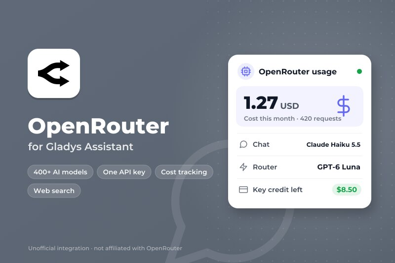
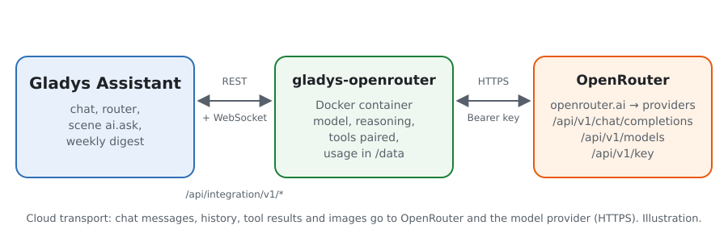
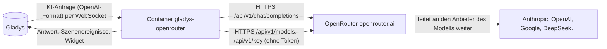
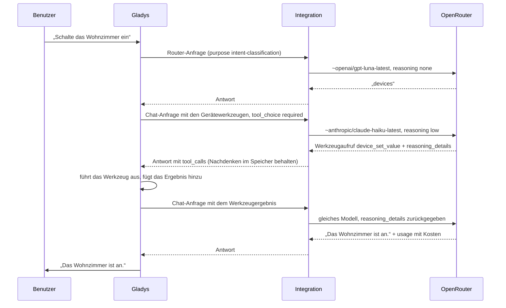
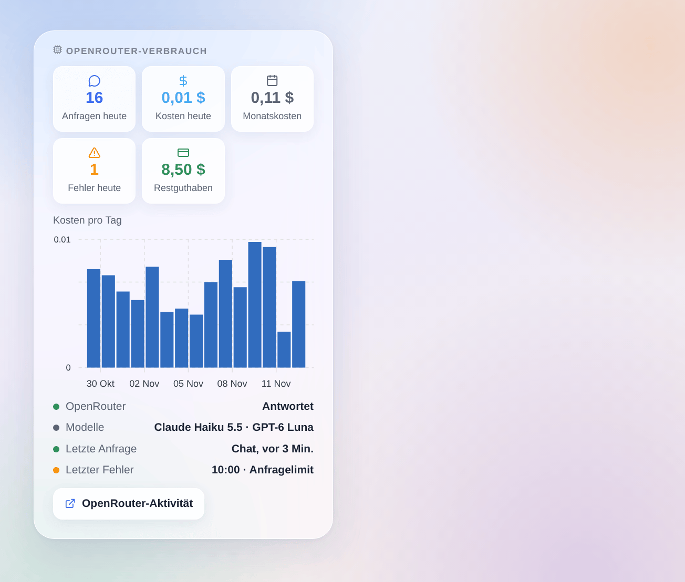

# Gladys OpenRouter

[English](README.md) · [Français](README.fr.md) · **Deutsch** · [Español](README.es.md)

[](LICENSE)
[](https://github.com/William-De71/gladys-openrouter/releases)
[](https://github.com/William-De71/gladys-openrouter/actions/workflows/release.yml)
[](https://gladysassistant.com)



Externe Integration für [Gladys Assistant](https://gladysassistant.com), die den Assistenten von Gladys mit **OpenRouter** betreibt: mehr als 400 KI-Modelle (Claude, GPT, Gemini, DeepSeek, Mistral, kostenlose offene Modelle…) hinter einem API-Schlüssel und einem Prepaid-Guthaben. Sobald sie unter Einstellungen → Künstliche Intelligenz gewählt ist, beantwortet das Modell deiner Wahl den Chat, steuert deine Geräte, erstellt Szenen, beantwortet die Szenenaktion „KI fragen“ und schreibt den Wochenrückblick — mit oder ohne Gladys-Plus-Konto.

Benutzerdokumentation: [English](docs/en.md) · [Français](docs/fr.md) · [Deutsch](docs/de.md) · [Español](docs/es.md).

Nicht mit OpenRouter verbunden. **Noch nicht mit einem echten OpenRouter-Schlüssel getestet**: Die Anfragen folgen der offiziellen API-Referenz von OpenRouter und seiner öffentlichen Modellliste, und die Tests laufen gegen eine nachgebildete API. Rückmeldungen sind willkommen.

## Funktionen

- **KI-Anbieter** (`type: "ai"`, Gladys 5.3+): Jede KI-Anfrage von Gladys läuft über OpenRouter — der Chat mit seinen Werkzeugaufrufen, der Intent-Router, die Szenenaktion „KI fragen“, der Wochenrückblick.
- **Zwei Modelle**: ein Chat-Modell (standardmäßig Claude Haiku) und ein schnelles Router-Modell (standardmäßig GPT Luna), gewählt aus Aliasen, die dem neuesten Modell jeder Familie folgen, den Routern Auto und Free von OpenRouter oder einer beliebigen anderen Modell-ID.
- **Nachdenk-Stufe** des Chat-Modells (aus, niedrig, mittel, hoch), angepasst an das, was jedes Modell akzeptiert, gelesen aus dem Live-Modellkatalog; das Nachdenken von Claude, Gemini und GPT wird mit den Werkzeugergebnissen zurückgegeben.
- **Datenschutz**: Beschränke die Anfragen auf Anbieter ohne Datenerfassung oder ohne Speicherung.
- **Szenenaktion „mit Websuche fragen“**: Das Chat-Modell sucht im Web und antwortet kurz (Nachrichten, Verkehr, ein Ereignis); Antwort und Quellen sind Ausgaben für die folgenden Aktionen.
- **Szenenauslöser**: Der Assistent hat einen Fehler (Schlüssel abgelehnt, keine Credits mehr, Anfragelimit, Modell nicht verfügbar, API nicht erreichbar) und antwortet wieder — einmal pro Ausfall.
- **Dashboard-Widget**: Anfragen, Kosten des Tages und des Monats, verbleibendes Guthaben des Schlüssels (oder kostenlose Anfragen des Tages), Kosten pro Tag über 30 Tage, letzte Antwort und letzter Fehler.
- Schaltfläche **Verbindung testen**; der Konfigurationsbildschirm zeigt, ob OpenRouter den Schlüssel akzeptiert und die Modelle kennt, ohne etwas auszugeben.
- Englisch, Französisch, Deutsch und Spanisch.

## Funktionsweise





Die ganze Agenten-Schleife (Prompts, Werkzeuge, Verlauf, Verkleinern der Bilder) bleibt in Gladys; die Integration wählt das Modell und bereitet jede Anfrage und ihre Antwort auf:



Was die Integration übernimmt: Werkzeugaufrufe und -ergebnisse immer paarweise (die IDs, die Gladys für Aufrufe ohne ID schreibt, etwa `unknown`, erhalten stabile; ein einzelner Aufruf erhält ein Platzhalter-Ergebnis), die `reasoning_details` nachdenkender Modelle, pro Aufruf-ID behalten und mit den Ergebnissen zurückgegeben, der Nachdenk-Aufwand, der dem am nächsten kommt, was jedes Modell akzeptiert, Fehler, die in einer HTTP-200-Antwort ankommen, und die Grenzen, die Gladys einer Antwort setzt. Ein 429 oder 5xx wird wiederholt, solange die Wartezeit des Kerns es erlaubt (18 s für den Router, 110 s für den Chat); ein 402 (keine Credits) nie.

### Transport

`transports: ["cloud"]`: Alles geht per HTTPS an `openrouter.ai` und dann an den Anbieter des Modells. **OpenRouter und dieser Anbieter sehen jede Chat-Nachricht, den Verlauf, die Definitionen und Ergebnisse der Werkzeuge (den Zustand der Geräte, die der Assistent abfragt) und die Bilder des Chats**, und die Antworten steuern deine Geräte und Szenen. Gladys weicht nie auf Gladys Plus aus, wenn OpenRouter fehlschlägt: Der Chat sagt, was nicht stimmt. `/data` speichert nur die Verbrauchszähler des Widgets.

## Modelle

| Auswahl                         | Modell-ID                         | Verwendung                                                           | Nachdenken                  |
| ------------------------------- | --------------------------------- | -------------------------------------------------------------------- | --------------------------- |
| Claude Haiku, neueste Version   | `~anthropic/claude-haiku-latest`  | Chat (Standard): schnell, günstig, zuverlässig mit Werkzeugen        | aus bis hoch                |
| Claude Sonnet, neueste Version  | `~anthropic/claude-sonnet-latest` | Chat: am leistungsfähigsten, etwa 20-mal so teuer wie Haiku          | immer an (niedrig bis hoch) |
| GPT Terra, neueste Version      | `~openai/gpt-terra-latest`        | Chat                                                                 | aus bis hoch                |
| GPT Luna, neueste Version       | `~openai/gpt-luna-latest`         | Router (Standard) oder günstiger Chat                                | aus bis hoch                |
| Gemini Flash, neueste Version   | `~google/gemini-flash-latest`     | Chat                                                                 | immer an (niedrig bis hoch) |
| DeepSeek Flash, neueste Version | `~deepseek/deepseek-flash-latest` | Chat oder Router, sehr günstig                                       | aus, niedrig, hoch          |
| Auto Router                     | `openrouter/auto`                 | Chat: OpenRouter wählt ein Modell pro Anfrage                        | wie eingestellt             |
| Kostenlose Modelle              | `openrouter/free`                 | Chat oder Router: kostenlos, 50 Anfragen pro Tag (1.000 mit Credits) | wie eingestellt             |
| Anderes Modell                  | deine ID                          | Jedes Modell von openrouter.ai/models, das Werkzeuge unterstützt     | laut Katalog                |

Die Aliase `~…-latest` verschiebt OpenRouter auf das neueste Modell jeder Familie (geprüft am 22. November 2026: Claude Haiku 5.5, Claude Sonnet 5.5, GPT-6.1 Terra, GPT-6 Luna, Gemini 4 Hydrogen, DeepSeek V4.1 Flash); Protokolle, Status und Widget zeigen den echten Namen. Der Status der Konfiguration warnt, wenn ein Modell keine Werkzeuge aufrufen kann.

## Szenen und Widget



- **Aktion „OpenRouter: mit Websuche fragen“**: Felder `question` (Szenenvariablen erlaubt), `instructions` (optional); Ausgaben `answer` und `sources` (eine pro Zeile). Nutzt das Chat-Modell mit dem `web`-Plugin von OpenRouter, Suchmaschine Exa, 5 Ergebnisse (etwa $0.007 pro Suche zusätzlich zu den Tokens).
- **Auslöser „OpenRouter: Der Assistent hat einen Fehler“**: Variablen `kind` (`auth`, `credits`, `rate_limit`, `model`, `unreachable`, `timeout`, `server`), `message`, `use`, `model`; Filter nach Art. Eine abgelehnte Anfrage (HTTP 400, Moderation, ein Modell, das keine Bilder lesen kann) betrifft nur diese Anfrage und löst nichts aus.
- **Auslöser „OpenRouter: Der Assistent antwortet wieder“**: Variable `down_minutes`.
- **Widget „OpenRouter-Verbrauch“**: von der Integration aus dem `usage` jeder Antwort gezählt (Kosten in Credits, 1 Credit = 1 US-Dollar); Anfragen außerhalb von Gladys mit demselben Schlüssel sind nicht enthalten. Was dem Schlüssel bleibt, kommt von `GET /api/v1/key`. Für die Rechnung bleibt die Aktivitätsseite von OpenRouter maßgeblich.

Beispiele:

- _Jeden Morgen um 7:30_ → **mit Websuche fragen** „die drei wichtigsten Nachrichten des Tages in Frankreich, in drei kurzen Sätzen“ → `{{answer}}` per Telegram senden.
- _Wenn der Assistent einen Fehler hat_ (Art `credits`) → dem Administrator eine SMS senden: „OpenRouter-Credits aufgebraucht“.
- _Vor dem Losfahren_ → **mit Websuche fragen** „Verkehr auf der A7 zwischen Lyon und Valence jetzt“ → die Antwort über den Lautsprecher im Flur ansagen.

## Voraussetzungen

- Gladys Assistant **5.3.0** oder neuer (KI-Anbieter); ältere Instanzen können die Integration nicht installieren.
- Ein OpenRouter-Konto und ein API-Schlüssel von [openrouter.ai/keys](https://openrouter.ai/keys).

### Credits und Grenzen

- **Kostenpflichtige Modelle**: pro Token von deinen Prepaid-Credits abgerechnet, zum Preis des Anbieters; OpenRouter erhebt eine Gebühr beim Kauf der Credits, nicht auf die Tokens. Ein Kreditlimit auf dem Schlüssel begrenzt, was Gladys ausgeben kann.
- **Kostenlose Modelle**: 20 Anfragen pro Minute und 50 pro Tag, 1.000 pro Tag, sobald 10 Credits gekauft wurden (Zurücksetzung um Mitternacht UTC). Eine Chat-Runde macht mindestens zwei Anfragen (Router, dann Chat), mehr, wenn Werkzeuge aufgerufen werden.
- **Datenschutz**: Standardmäßig darf jeder Anbieter des Modells die Anfrage bedienen; die Einstellung **Anbieter** schränkt das ein (`provider.data_collection: "deny"` oder `provider.zdr: true`).

## Installation

- **Aus dem Store**: Integrationen → OpenRouter → Installieren.
- **Über die Repository-URL**: Integrationen → externe Integration → `https://github.com/William-De71/gladys-openrouter`.
- **Entwicklermodus**: Starte `npm start` mit den Variablen, die Gladys vorgibt (siehe Entwicklung).

## Konfiguration

| Feld oder Schaltfläche   | Standard                      | Bedeutung                                                                                |
| ------------------------ | ----------------------------- | ---------------------------------------------------------------------------------------- |
| OpenRouter-API-Schlüssel | —                             | Pflicht, ein Geheimnis: nie wieder angezeigt, nie protokolliert                          |
| Chat-Modell              | Claude Haiku, neueste Version | Chat, Szenenerstellung, Wochenrückblick, Websuche-Aktion                                 |
| Router-Modell            | GPT Luna, neueste Version     | Ordnet jede Nachricht vor der Antwort ein, innerhalb von 20 s                            |
| ID des anderen Modells   | —                             | Verwendet, wenn ein Modell auf „Anderes Modell“ steht                                    |
| Nachdenken               | niedrig                       | Das des Chat-Modells; der Router erhält die niedrigste Stufe, die sein Modell akzeptiert |
| Maximale Antwortlänge    | 8000 Tokens                   | Nachdenken inbegriffen; erhöhe sie, wenn die Protokolle max_tokens erreicht melden       |
| Anbieter                 | Alle Anbieter des Modells     | Oder ohne Datenerfassung, oder nur ohne Speicherung                                      |
| Verbindung testen        | —                             | Eine kurze Antwort jedes Modells, mit seiner Zeit (ein Bruchteil eines Cents)            |

## Verwendung

1. In Gladys (Integrationen → OpenRouter → Konfiguration): API-Schlüssel einfügen, die Modelle wählen; **Verbindung testen** drücken.
2. Einstellungen → **Künstliche Intelligenz**: **OpenRouter** als Anbieter wählen.
3. Sprich mit Gladys im Chat; füge das Widget einem Dashboard hinzu; nutze die Auslöser und die Websuche-Aktion in deinen Szenen.

## Entwicklung

```bash
npm install
npm test                       # node --test, eine nachgebildete OpenRouter-API auf 127.0.0.1, nie das Netzwerk
npm run lint                   # ESLint
npm run format:check           # Prettier
npx github:GladysAssistant/integration-store . --skip-image-check
scripts/build-cover.sh         # cover.jpg aus docs/assets/cover.svg
docs/illustrations/render.sh   # docs/assets/widgets.<sprache>.png
```

Lokal liest das SDK `GLADYS_HOST_API_URL`, `GLADYS_INTEGRATION_TOKEN` und `GLADYS_INTEGRATION_SELECTOR` (von Gladys im Entwicklermodus vorgegeben), und die Integration liest `TZ`. `DEBUG=gladys-integration-sdk` zeigt die Protokolle des SDK.

Die Tests decken den HTTP-Client ab (Fehler, Fehler in einer 200-Antwort, Wiederholungen, Fristen), den Modellkatalog, die Umwandlung in beide Richtungen (`validateAiCompletion` des SDK, Paarung, Nachdenk-Details), den Chat-Handler (Modelle je Zweck, Nachdenken, Datenschutz, abgelehnter Parameter), die Websuche, die Auslöser, die Verbrauchszähler, das Widget (`validateWidgetContent`), das Manifest, die vier Sprachen, das Release-Skript und die ganze Integration gegen das nachgebildete Gladys des SDK. `test/structure.test.js` friert jeden Schlüssel ein, den Benutzer speichern.

## Release-Prozess


Jeder Merge auf `main` startet die CI und berechnet dann die Version aus den [Conventional Commits](https://www.conventionalcommits.org/) seit dem letzten Tag: `feat` → Minor, `fix` / `perf` → Patch, `!` oder `BREAKING CHANGE` → Major (ein Minor unter 1.0.0); `docs`, `chore`, `ci`, `test`, `style`, `refactor`, `build` allein veröffentlichen nichts. Der Changelog-Abschnitt wird erzeugt, der Tag gepusht, das Multi-Architektur-Image gebaut, dann erhält `main` den Release-Commit, das GitHub Release wird erstellt und ein letzter Job prüft das öffentliche Image, den Store-Validator und das Topic.

- Der Titel des Pull Requests wird zum Squash-Commit und dann zur Changelog-Zeile: Schreibe ihn auf Englisch, für die Benutzer (`pr-title.yml` prüft ihn). Bearbeite `CHANGELOG.md` nie von Hand.
- 1.0.0 ist eine Entscheidung: Actions → Release → Run workflow mit `release-as: 1.0.0`. `dry-run` zeigt Version und Notizen, ohne zu veröffentlichen.
- **Geschützter Branch**: Das Release pusht seinen Commit mit `GITHUB_TOKEN` auf `main`. Das Ruleset `protect-main` (kein Löschen, kein Force-Push) lässt ihn durch; eine strengere Regel (Pull Request Pflicht, Status-Checks) bräuchte GitHub Actions in ihrer Bypass-Liste oder eine GitHub App.
- Mache nach dem ersten Release das `ghcr.io`-Paket öffentlich (Package settings → Change visibility), sonst kann Gladys es nicht herunterladen.

## Fehlerbehebung

Siehe [docs/de.md](docs/de.md#fehlerbehebung). Melde Probleme mit den Versionen von Gladys und der Integration, den gewählten Modellen, der Einstellung Anbieter und der Meldung von **Verbindung testen**. Füge nie deinen API-Schlüssel ein.

## Mitwirken

Issues und Pull Requests sind willkommen, besonders von Leuten mit einem OpenRouter-Schlüssel: Eine fehlschlagende Anfrage (ohne den Schlüssel) hilft sehr. Führe `npm run format:check && npm run lint && npm test` aus, bevor du einen Pull Request öffnest, und lass jeden gespeicherten Schlüssel unverändert (siehe [CLAUDE.md](CLAUDE.md)).

## Sicherheit

Siehe [SECURITY.md](SECURITY.md): Melde Sicherheitslücken vertraulich. Der API-Schlüssel ist ein `secret`-Feld: nie protokolliert, nie in `/data` geschrieben, nur per HTTPS an `openrouter.ai` gesendet.

## Kommende Screenshots

Die Bilder oben sind Illustrationen, keine Screenshots. Echte Screenshots kommen nach `docs/assets/screenshots/` (PNG, 1280 × 800): `configuration.png` (die Konfiguration mit ihrem Status), `ai-settings.png` (OpenRouter gewählt unter Einstellungen → Künstliche Intelligenz), `chat.png` (ein Chat, der ein Gerät einschaltet), `scene-web-search.png` (die Websuche-Aktion in einer Szene).

## Lizenz

[Apache License 2.0](LICENSE) — siehe auch [NOTICE](NOTICE). OpenRouter ist eine Marke von OpenRouter, Inc.; die Modellnamen gehören ihren Inhabern. Dieses Projekt ist weder mit OpenRouter verbunden noch von OpenRouter unterstützt oder gesponsert. Danke an die Dokumentation und das SDK von Gladys sowie an die Dokumentation von OpenRouter.
