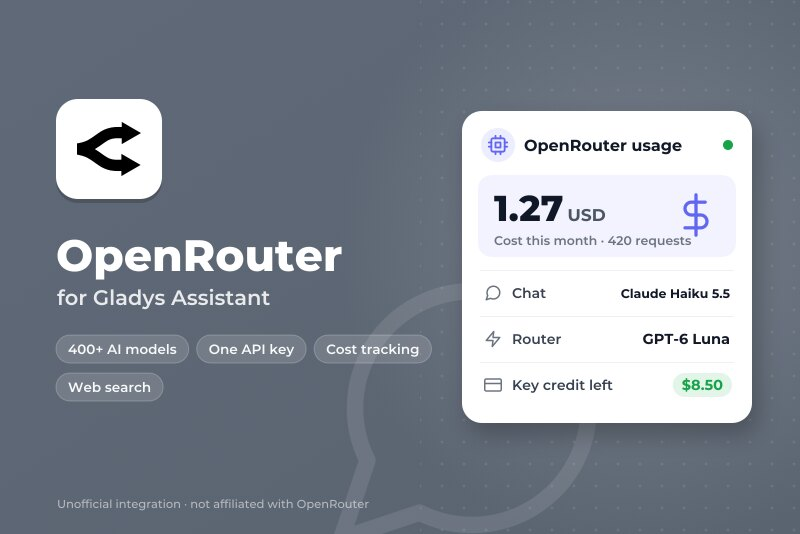
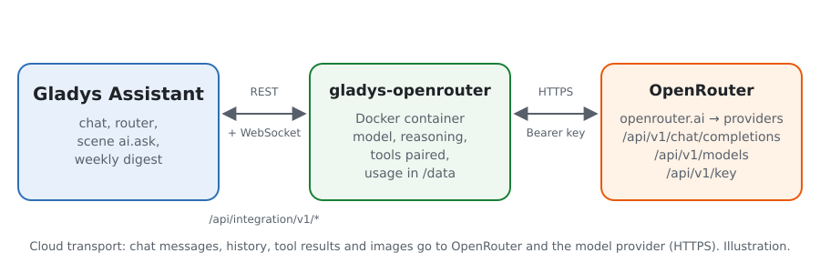
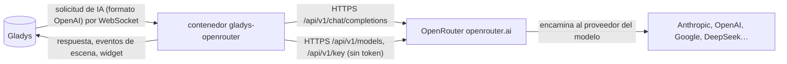
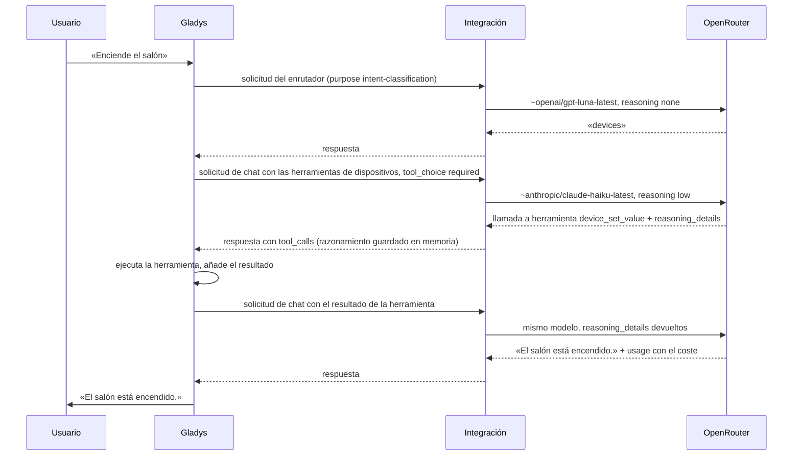
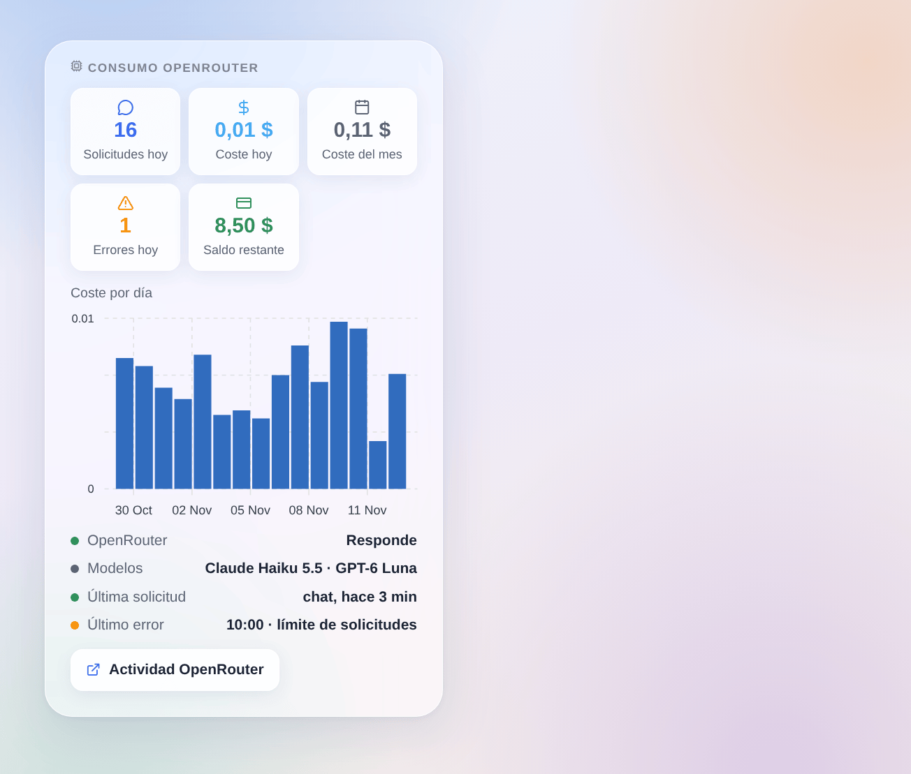

# Gladys OpenRouter

[English](README.md) · [Français](README.fr.md) · [Deutsch](README.de.md) · **Español**

[](LICENSE)
[](https://github.com/William-De71/gladys-openrouter/releases)
[](https://github.com/William-De71/gladys-openrouter/actions/workflows/release.yml)
[](https://gladysassistant.com)



Integración externa para [Gladys Assistant](https://gladysassistant.com) que hace funcionar el asistente de Gladys con **OpenRouter**: más de 400 modelos de IA (Claude, GPT, Gemini, DeepSeek, Mistral, modelos abiertos gratuitos…) detrás de una sola clave de API y un solo saldo prepago. Una vez elegida en Ajustes → Inteligencia artificial, el modelo que usted elija responde al chat, controla sus dispositivos, crea escenas, responde a la acción de escena «preguntar a la IA» y redacta el resumen semanal — con o sin cuenta de Gladys Plus.

Documentación de usuario: [English](docs/en.md) · [Français](docs/fr.md) · [Deutsch](docs/de.md) · [Español](docs/es.md).

Sin relación con OpenRouter. **Todavía no probada con una clave real de OpenRouter**: las solicitudes siguen la referencia oficial de la API de OpenRouter y su lista pública de modelos, y las pruebas se ejecutan contra una API simulada. Se agradecen los comentarios.

## Funciones

- **Proveedor de IA** (`type: "ai"`, Gladys 5.3+): cada solicitud de IA de Gladys pasa por OpenRouter — el chat con sus llamadas a herramientas, el enrutador de intenciones, la acción de escena «preguntar a la IA», el resumen semanal.
- **Dos modelos**: un modelo de chat (Claude Haiku por defecto) y un modelo rápido para el enrutador (GPT Luna por defecto), elegidos entre alias que siguen al modelo más reciente de cada familia, los enrutadores Auto y Free de OpenRouter o cualquier otro identificador de modelo.
- **Nivel de razonamiento** del modelo del chat (desactivado, bajo, medio, alto), adaptado a lo que acepta cada modelo, leído del catálogo de modelos en vivo; el razonamiento de Claude, Gemini y GPT se devuelve con los resultados de las herramientas.
- **Privacidad**: limite las solicitudes a proveedores sin recogida de datos, o con retención cero.
- **Acción de escena «preguntar con búsqueda web»**: el modelo del chat busca en la web y responde brevemente (noticias, tráfico, un evento); la respuesta y las fuentes son salidas para las acciones siguientes.
- **Disparadores de escena**: el asistente falla (clave rechazada, sin créditos, límite de solicitudes, modelo no disponible, API inaccesible) y vuelve a responder — una vez por fallo.
- **Widget del panel**: solicitudes, coste del día y del mes, crédito que le queda a la clave (o solicitudes gratuitas del día), coste por día durante 30 días, última respuesta y último error.
- Botón **Probar la conexión**; la pantalla de configuración indica si OpenRouter acepta la clave y conoce los modelos, sin gastar nada.
- Inglés, francés, alemán y español.

## Funcionamiento





Todo el bucle de agente (instrucciones, herramientas, historial, redimensionado de imágenes) se queda en Gladys; la integración elige el modelo y prepara cada solicitud y su respuesta:



Lo que gestiona la integración: llamadas y resultados de herramientas siempre emparejados (los identificadores que Gladys escribe para las llamadas que no tienen, como `unknown`, reciben unos estables; una llamada suelta recibe un resultado de relleno), los `reasoning_details` de los modelos que razonan, guardados por identificador de llamada y devueltos con los resultados, el esfuerzo de razonamiento más cercano a lo que acepta cada modelo, los errores que llegan dentro de una respuesta HTTP 200 y los límites que Gladys impone a una respuesta. Un 429 o un 5xx se reintenta mientras el tiempo de espera del núcleo lo permita (18 s para el enrutador, 110 s para el chat); un 402 (sin créditos), nunca.

### Transporte

`transports: ["cloud"]`: todo va a `openrouter.ai` por HTTPS y después al proveedor del modelo. **OpenRouter y ese proveedor ven cada mensaje del chat, el historial, las definiciones y los resultados de las herramientas (el estado de los dispositivos que consulta el asistente) y las imágenes del chat**, y las respuestas controlan sus dispositivos y escenas. Gladys nunca recurre a Gladys Plus cuando OpenRouter falla: el chat dice qué pasa. `/data` solo guarda los contadores de consumo del widget.

## Modelos

| Opción                         | Identificador del modelo          | Uso                                                                   | Razonamiento                    |
| ------------------------------ | --------------------------------- | --------------------------------------------------------------------- | ------------------------------- |
| Claude Haiku, última versión   | `~anthropic/claude-haiku-latest`  | Chat (por defecto): rápido, barato, fiable con las herramientas       | de desactivado a alto           |
| Claude Sonnet, última versión  | `~anthropic/claude-sonnet-latest` | Chat: el más capaz, unas 20 veces el precio de Haiku                  | siempre activo (de bajo a alto) |
| GPT Terra, última versión      | `~openai/gpt-terra-latest`        | Chat                                                                  | de desactivado a alto           |
| GPT Luna, última versión       | `~openai/gpt-luna-latest`         | Enrutador (por defecto) o chat barato                                 | de desactivado a alto           |
| Gemini Flash, última versión   | `~google/gemini-flash-latest`     | Chat                                                                  | siempre activo (de bajo a alto) |
| DeepSeek Flash, última versión | `~deepseek/deepseek-flash-latest` | Chat o enrutador, muy barato                                          | desactivado, bajo, alto         |
| Auto Router                    | `openrouter/auto`                 | Chat: OpenRouter elige un modelo por solicitud                        | según el ajuste                 |
| Modelos gratuitos              | `openrouter/free`                 | Chat o enrutador: gratuito, 50 solicitudes al día (1000 con créditos) | según el ajuste                 |
| Otro modelo                    | su identificador                  | Cualquier modelo de openrouter.ai/models que admita herramientas      | según el catálogo               |

OpenRouter mueve los alias `~…-latest` al modelo más reciente de cada familia (comprobado el 22 de noviembre de 2026: Claude Haiku 5.5, Claude Sonnet 5.5, GPT-6.1 Terra, GPT-6 Luna, Gemini 4 Hydrogen, DeepSeek V4.1 Flash); los registros, el estado y el widget muestran el nombre real. El estado de la configuración avisa cuando un modelo no puede llamar a herramientas.

## Escenas y widget



- **Acción «OpenRouter: preguntar con búsqueda web»**: campos `question` (se admiten variables de escena), `instructions` (opcional); salidas `answer` y `sources` (una por línea). Usa el modelo del chat con el plugin `web` de OpenRouter, motor Exa, 5 resultados (unos $0.007 por búsqueda además de los tokens).
- **Disparador «OpenRouter: el asistente falla»**: variables `kind` (`auth`, `credits`, `rate_limit`, `model`, `unreachable`, `timeout`, `server`), `message`, `use`, `model`; filtro por tipo. Una solicitud rechazada (HTTP 400, moderación, un modelo que no lee imágenes) solo afecta a esa solicitud y no dispara nada.
- **Disparador «OpenRouter: el asistente vuelve a responder»**: variable `down_minutes`.
- **Widget «Consumo OpenRouter»**: lo cuenta la integración a partir del `usage` de cada respuesta (coste en créditos, 1 crédito = 1 dólar estadounidense); las solicitudes hechas fuera de Gladys con la misma clave no aparecen. Lo que le queda a la clave viene de `GET /api/v1/key`. La página de actividad de OpenRouter sigue siendo la referencia para la factura.

Ejemplos:

- _Cada mañana a las 7:30_ → **preguntar con búsqueda web** «las tres noticias principales del día en Francia, en tres frases cortas» → enviar `{{answer}}` por Telegram.
- _Cuando el asistente falla_ (tipo `credits`) → enviar un SMS al administrador: «Créditos de OpenRouter agotados».
- _Antes de salir_ → **preguntar con búsqueda web** «tráfico en la A7 entre Lyon y Valence ahora» → anunciar la respuesta en el altavoz de la entrada.

## Requisitos

- Gladys Assistant **5.3.0** o posterior (proveedores de IA); las instancias más antiguas no pueden instalar la integración.
- Una cuenta de OpenRouter y una clave de API de [openrouter.ai/keys](https://openrouter.ai/keys).

### Créditos y límites

- **Modelos de pago**: se facturan por token de sus créditos prepago, al precio del proveedor; OpenRouter cobra una comisión al comprar los créditos, no sobre los tokens. Un límite de crédito en la clave pone tope a lo que Gladys puede gastar.
- **Modelos gratuitos**: 20 solicitudes por minuto y 50 al día, 1000 al día una vez comprados 10 créditos (se reinician a medianoche UTC). Un turno de chat hace al menos dos solicitudes (enrutador y luego chat), más cuando se llaman herramientas.
- **Privacidad**: por defecto, cualquier proveedor del modelo puede atender la solicitud; el ajuste **Proveedores** lo restringe (`provider.data_collection: "deny"`, o `provider.zdr: true`).

## Instalación

- **Desde la tienda**: Integraciones → OpenRouter → Instalar.
- **Desde la URL del repositorio**: Integraciones → integración externa → `https://github.com/William-De71/gladys-openrouter`.
- **Modo desarrollador**: ejecute `npm start` con las variables que proporciona Gladys (vea Desarrollo).

## Configuración

| Campo o botón                    | Por defecto                      | Significado                                                                         |
| -------------------------------- | -------------------------------- | ----------------------------------------------------------------------------------- |
| Clave de API de OpenRouter       | —                                | Obligatoria, un secreto: nunca se vuelve a mostrar ni se registra                   |
| Modelo del chat                  | Claude Haiku, última versión     | Chat, creación de escenas, resumen semanal, acción de búsqueda web                  |
| Modelo del enrutador             | GPT Luna, última versión         | Clasifica cada mensaje antes de la respuesta, en menos de 20 s                      |
| Identificador del otro modelo    | —                                | Se usa cuando un modelo está en «Otro modelo»                                       |
| Razonamiento                     | bajo                             | El del modelo del chat; el enrutador recibe el nivel más bajo que acepta su modelo  |
| Longitud máxima de una respuesta | 8000 tokens                      | Razonamiento incluido; auméntela si los registros indican que se alcanzó max_tokens |
| Proveedores                      | Todos los proveedores del modelo | O sin recogida de datos, o solo retención cero                                      |
| Probar la conexión               | —                                | Una respuesta corta de cada modelo, con su tiempo (una fracción de céntimo)         |

## Uso

1. En Gladys (Integraciones → OpenRouter → Configuración): pegue la clave de API, elija los modelos; pulse **Probar la conexión**.
2. Ajustes → **Inteligencia artificial**: elija **OpenRouter** como proveedor.
3. Hable con Gladys en el chat; añada el widget a un panel; use los disparadores y la acción de búsqueda web en sus escenas.

## Desarrollo

```bash
npm install
npm test                       # node --test, una API de OpenRouter simulada en 127.0.0.1, nunca la red
npm run lint                   # ESLint
npm run format:check           # Prettier
npx github:GladysAssistant/integration-store . --skip-image-check
scripts/build-cover.sh         # cover.jpg a partir de docs/assets/cover.svg
docs/illustrations/render.sh   # docs/assets/widgets.<idioma>.png
```

En local, el SDK lee `GLADYS_HOST_API_URL`, `GLADYS_INTEGRATION_TOKEN` y `GLADYS_INTEGRATION_SELECTOR` (proporcionadas por Gladys en modo desarrollador), y la integración lee `TZ`. `DEBUG=gladys-integration-sdk` muestra los registros del SDK.

Las pruebas cubren el cliente HTTP (errores, errores dentro de una respuesta 200, reintentos, plazos), el catálogo de modelos, la conversión en ambos sentidos (`validateAiCompletion` del SDK, emparejamiento, detalles de razonamiento), el gestor del chat (modelos según el uso, razonamiento, privacidad, parámetro rechazado), la búsqueda web, los disparadores, los contadores de consumo, el widget (`validateWidgetContent`), el manifiesto, los cuatro idiomas, el script de publicación y toda la integración frente al Gladys simulado del SDK. `test/structure.test.js` congela cada clave que guardan los usuarios.

## Proceso de publicación


Cada fusión en `main` lanza la CI y luego calcula la versión a partir de los [Conventional Commits](https://www.conventionalcommits.org/) desde la última etiqueta: `feat` → menor, `fix` / `perf` → parche, `!` o `BREAKING CHANGE` → mayor (una menor por debajo de 1.0.0); `docs`, `chore`, `ci`, `test`, `style`, `refactor`, `build` solos no publican nada. Se genera la sección del changelog, se sube la etiqueta, se construye la imagen multiarquitectura, luego `main` recibe el commit de publicación, se crea la GitHub Release y un último job comprueba la imagen pública, el validador de la tienda y el topic.

- El título de la pull request se convierte en el commit de squash y luego en la línea del changelog: escríbalo en inglés, para el usuario (`pr-title.yml` lo comprueba). No edite nunca `CHANGELOG.md` a mano.
- La 1.0.0 es una decisión: Actions → Release → Run workflow con `release-as: 1.0.0`. `dry-run` muestra la versión y las notas sin publicar nada.
- **Rama protegida**: unos rulesets exigen una pull request en `main` y bloquean las etiquetas `v*`; solo pasan el mantenedor y las deploy keys. La publicación hace push con la deploy key del entorno `release` (secreto `RELEASE_DEPLOY_KEY`, solo `main`): una ejecución lanzada desde otra rama nunca la obtiene. `build.yml` y `github-release.yml` no arrancan con una etiqueta: la publicación los llama, o lánzelos a mano (Actions → Run workflow, con `version` para la imagen) para terminar una publicación.
- Tras la primera publicación, haga público el paquete `ghcr.io` (Package settings → Change visibility); si no, Gladys no puede descargarlo.

## Solución de problemas

Vea [docs/es.md](docs/es.md#solución-de-problemas). Informe de los problemas con las versiones de Gladys y de la integración, los modelos elegidos, el ajuste Proveedores y el mensaje de **Probar la conexión**. No pegue nunca su clave de API.

## Contribuir

Las issues y pull requests son bienvenidas, sobre todo de personas con una clave de OpenRouter: una solicitud que falla (sin la clave) ayuda mucho. Ejecute `npm run format:check && npm run lint && npm test` antes de abrir una pull request y mantenga sin cambios cada clave guardada (vea [CLAUDE.md](CLAUDE.md)).

## Seguridad

Vea [SECURITY.md](SECURITY.md): informe de las vulnerabilidades en privado. La clave de API es un campo `secret`: nunca se registra, nunca se escribe en `/data`, solo se envía a `openrouter.ai` por HTTPS.

## Capturas pendientes

Las imágenes de arriba son ilustraciones, no capturas de pantalla. Las capturas reales irán en `docs/assets/screenshots/` (PNG, 1280 × 800): `configuration.png` (la configuración con su estado), `ai-settings.png` (OpenRouter elegido en Ajustes → Inteligencia artificial), `chat.png` (un chat que enciende un dispositivo), `scene-web-search.png` (la acción de búsqueda web en una escena).

## Licencia

[Apache License 2.0](LICENSE) — vea también [NOTICE](NOTICE). OpenRouter es una marca de OpenRouter, Inc.; los nombres de los modelos pertenecen a sus propietarios. Este proyecto no está afiliado a OpenRouter ni cuenta con su respaldo o patrocinio. Gracias a la documentación y al SDK de Gladys, y a la documentación de OpenRouter.
