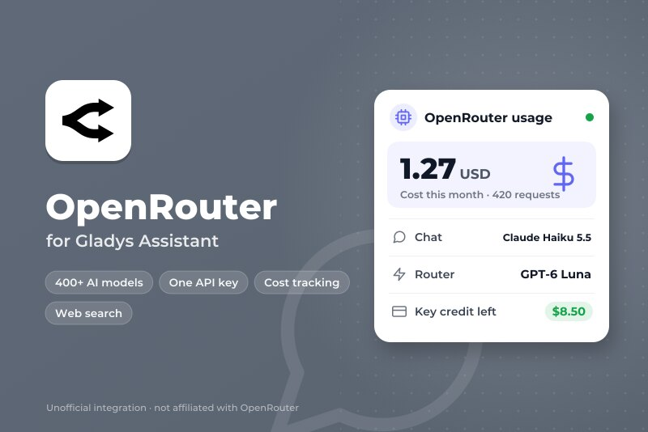
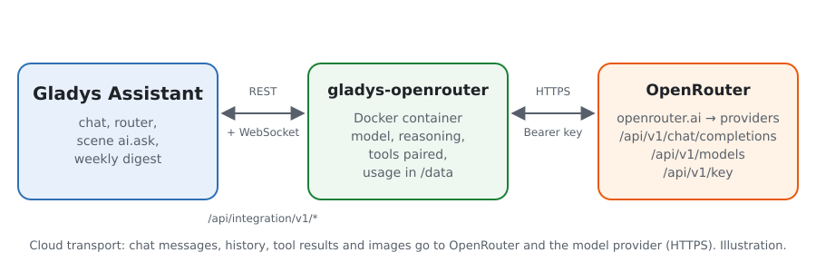
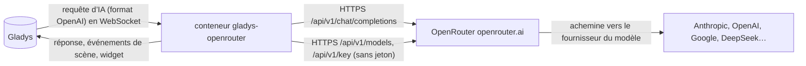
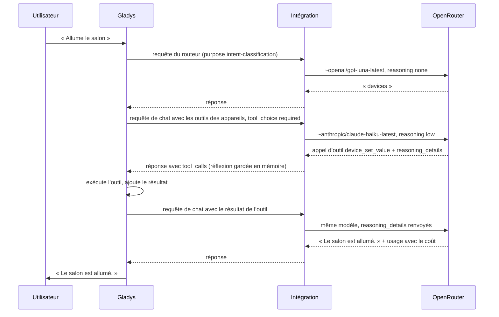
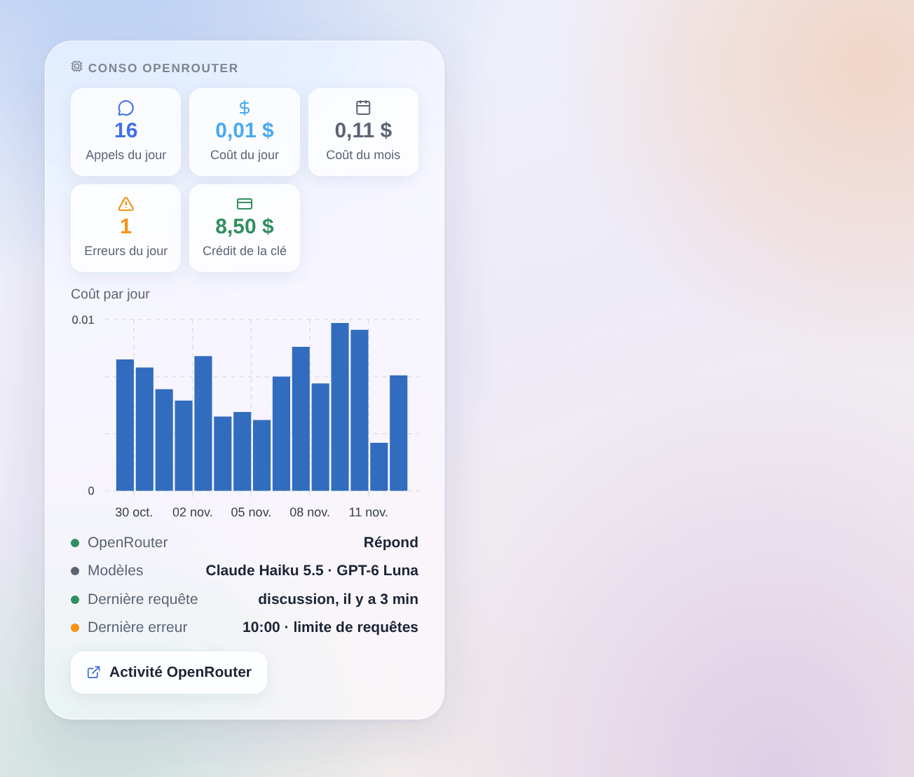

# Gladys OpenRouter

[English](README.md) · **Français** · [Deutsch](README.de.md) · [Español](README.es.md)

[](LICENSE)
[](https://github.com/William-De71/gladys-openrouter/releases)
[](https://github.com/William-De71/gladys-openrouter/actions/workflows/release.yml)
[](https://gladysassistant.com)



Intégration externe pour [Gladys Assistant](https://gladysassistant.com) qui fait tourner l’assistant de Gladys sur **OpenRouter** : plus de 400 modèles d’IA (Claude, GPT, Gemini, DeepSeek, Mistral, modèles ouverts gratuits…) derrière une seule clé d’API et un seul solde prépayé. Une fois choisi dans Paramètres → Intelligence artificielle, le modèle de votre choix répond au chat, pilote vos appareils, crée des scènes, répond à l’action de scène « demander à l’IA » et rédige le résumé hebdomadaire — avec ou sans compte Gladys Plus.

Documentation utilisateur : [English](docs/en.md) · [Français](docs/fr.md) · [Deutsch](docs/de.md) · [Español](docs/es.md).

Sans lien avec OpenRouter. **Pas encore testée avec une vraie clé OpenRouter** : les requêtes suivent la référence officielle de l’API d’OpenRouter et sa liste publique de modèles, et les tests tournent contre une fausse API. Les retours sont bienvenus.

## Fonctionnalités

- **Fournisseur d’IA** (`type: "ai"`, Gladys 5.3+) : chaque requête d’IA de Gladys passe par OpenRouter — le chat et ses appels d’outils, le routeur d’intentions, l’action de scène « demander à l’IA », le résumé hebdomadaire.
- **Deux modèles** : un modèle de chat (Claude Haiku par défaut) et un modèle rapide pour le routeur (GPT Luna par défaut), choisis parmi des alias qui suivent le modèle le plus récent de chaque famille, les routeurs Auto et Free d’OpenRouter, ou tout autre identifiant de modèle.
- **Niveau de réflexion** du modèle du chat (désactivée, faible, moyenne, élevée), adapté à ce que chaque modèle accepte, lu dans le catalogue en direct des modèles ; la réflexion de Claude, Gemini et GPT est renvoyée avec les résultats des outils.
- **Confidentialité** : limitez les requêtes aux fournisseurs sans collecte de données, ou à zéro conservation.
- **Action de scène « demander avec recherche web »** : le modèle du chat cherche sur le web et répond brièvement (actualités, trafic, un événement) ; la réponse et les sources sont des sorties pour les actions suivantes.
- **Déclencheurs de scène** : l’assistant est en erreur (clé refusée, plus de crédits, limite de requêtes, modèle indisponible, API injoignable) et répond de nouveau — une fois par panne.
- **Widget de tableau de bord** : requêtes, coût du jour et du mois, crédit restant sur la clé (ou requêtes gratuites du jour), coût par jour sur 30 jours, dernière réponse et dernière erreur.
- Bouton **Tester la connexion** ; l’écran de configuration indique si OpenRouter accepte la clé et connaît les modèles, sans rien dépenser.
- Anglais, français, allemand et espagnol.

## Fonctionnement





Toute la boucle d’agent (consignes, outils, historique, redimensionnement des images) reste dans Gladys ; l’intégration choisit le modèle et prépare chaque requête et sa réponse :



Ce que l’intégration gère : appels et résultats d’outils toujours appariés (les identifiants que Gladys écrit pour les appels qui n’en ont pas, comme `unknown`, en reçoivent de stables ; un appel isolé reçoit un résultat de remplacement), les `reasoning_details` des modèles qui réfléchissent, gardés par identifiant d’appel et renvoyés avec les résultats, l’effort de réflexion le plus proche de ce que chaque modèle accepte, les erreurs qui arrivent dans une réponse HTTP 200, et les bornes que Gladys impose à une réponse. Une erreur 429 ou 5xx est retentée tant que le délai d’attente du cœur le permet (18 s pour le routeur, 110 s pour le chat) ; une 402 (plus de crédits) jamais.

### Transport

`transports: ["cloud"]` : tout part vers `openrouter.ai` en HTTPS, puis chez le fournisseur du modèle. **OpenRouter et ce fournisseur voient chaque message du chat, l’historique, la définition et le résultat des outils (l’état des appareils que l’assistant consulte) et les images du chat**, et les réponses pilotent vos appareils et vos scènes. Gladys ne se replie jamais sur Gladys Plus quand OpenRouter échoue : le chat dit ce qui ne va pas. `/data` ne garde que les compteurs de consommation du widget.

## Modèles

| Choix                            | Identifiant du modèle             | Usage                                                                    | Réflexion                         |
| -------------------------------- | --------------------------------- | ------------------------------------------------------------------------ | --------------------------------- |
| Claude Haiku, dernière version   | `~anthropic/claude-haiku-latest`  | Chat (par défaut) : rapide, bon marché, fiable avec les outils           | de désactivée à élevée            |
| Claude Sonnet, dernière version  | `~anthropic/claude-sonnet-latest` | Chat : le plus capable, environ 20 fois le prix de Haiku                 | toujours active (faible à élevée) |
| GPT Terra, dernière version      | `~openai/gpt-terra-latest`        | Chat                                                                     | de désactivée à élevée            |
| GPT Luna, dernière version       | `~openai/gpt-luna-latest`         | Routeur (par défaut) ou chat bon marché                                  | de désactivée à élevée            |
| Gemini Flash, dernière version   | `~google/gemini-flash-latest`     | Chat                                                                     | toujours active (faible à élevée) |
| DeepSeek Flash, dernière version | `~deepseek/deepseek-flash-latest` | Chat ou routeur, très bon marché                                         | désactivée, faible, élevée        |
| Auto Router                      | `openrouter/auto`                 | Chat : OpenRouter choisit un modèle par requête                          | selon le réglage                  |
| Modèles gratuits                 | `openrouter/free`                 | Chat ou routeur : gratuit, 50 requêtes par jour (1 000 avec des crédits) | selon le réglage                  |
| Autre modèle                     | votre identifiant                 | Tout modèle d’openrouter.ai/models qui gère les outils                   | d’après le catalogue              |

Les alias `~…-latest` sont déplacés par OpenRouter vers le modèle le plus récent de chaque famille (vérifié le 22 novembre 2026 : Claude Haiku 5.5, Claude Sonnet 5.5, GPT-6.1 Terra, GPT-6 Luna, Gemini 4 Hydrogen, DeepSeek V4.1 Flash) ; les journaux, le statut et le widget affichent le vrai nom. Le statut de la configuration prévient quand un modèle ne sait pas appeler d’outils.

## Scènes et widget



- **Action « OpenRouter : demander avec recherche web »** : champs `question` (variables de scène acceptées), `instructions` (facultatif) ; sorties `answer` et `sources` (une par ligne). Utilise le modèle du chat avec le plugin `web` d’OpenRouter, moteur Exa, 5 résultats (environ $0.007 par recherche en plus des jetons).
- **Déclencheur « OpenRouter : l’assistant est en erreur »** : variables `kind` (`auth`, `credits`, `rate_limit`, `model`, `unreachable`, `timeout`, `server`), `message`, `use`, `model` ; filtre par type. Une requête refusée (HTTP 400, modération, un modèle qui ne lit pas les images) ne concerne que cette requête et ne déclenche rien.
- **Déclencheur « OpenRouter : l’assistant répond de nouveau »** : variable `down_minutes`.
- **Widget « Conso OpenRouter »** : compté par l’intégration à partir du `usage` de chaque réponse (coût en crédits, 1 crédit = 1 dollar américain) ; les requêtes faites hors de Gladys avec la même clé n’y sont pas. Ce qu’il reste sur la clé vient de `GET /api/v1/key`. La page d’activité d’OpenRouter reste la référence pour la facture.

Exemples :

- _Chaque matin à 7 h 30_ → **demander avec recherche web** « les trois principales actualités du jour en France, en trois phrases courtes » → envoyer `{{answer}}` par Telegram.
- _Quand l’assistant est en erreur_ (type `credits`) → envoyer un SMS à l’administrateur : « Crédits OpenRouter épuisés ».
- _Avant de partir_ → **demander avec recherche web** « trafic sur l’A7 entre Lyon et Valence maintenant » → annoncer la réponse sur l’enceinte de l’entrée.

## Prérequis

- Gladys Assistant **5.3.0** ou plus récent (fournisseurs d’IA) ; les instances plus anciennes ne peuvent pas installer l’intégration.
- Un compte OpenRouter et une clé d’API créée sur [openrouter.ai/keys](https://openrouter.ai/keys).

### Crédits et limites

- **Modèles payants** : facturés au jeton sur vos crédits prépayés, au prix du fournisseur ; OpenRouter prend des frais à l’achat des crédits, pas sur les jetons. Une limite de crédit sur la clé plafonne ce que Gladys peut dépenser.
- **Modèles gratuits** : 20 requêtes par minute et 50 par jour, 1 000 par jour une fois 10 crédits achetés (remise à zéro à minuit UTC). Un tour de chat fait au moins deux requêtes (routeur, puis chat), plus quand des outils sont appelés.
- **Confidentialité** : par défaut, n’importe quel fournisseur du modèle peut servir la requête ; le réglage **Fournisseurs** le restreint (`provider.data_collection: "deny"`, ou `provider.zdr: true`).

## Installation

- **Depuis le store** : Intégrations → OpenRouter → Installer.
- **Depuis l’URL du dépôt** : Intégrations → intégration externe → `https://github.com/William-De71/gladys-openrouter`.
- **Mode développeur** : lancez `npm start` avec les variables fournies par Gladys (voir Développement).

## Configuration

| Champ ou bouton                 | Par défaut                      | Rôle                                                                                     |
| ------------------------------- | ------------------------------- | ---------------------------------------------------------------------------------------- |
| Clé d’API OpenRouter            | —                               | Obligatoire, un secret : plus jamais affichée, jamais journalisée                        |
| Modèle du chat                  | Claude Haiku, dernière version  | Chat, création de scènes, résumé hebdomadaire, action de recherche web                   |
| Modèle du routeur               | GPT Luna, dernière version      | Trie chaque message avant la réponse, en moins de 20 s                                   |
| Identifiant de l’autre modèle   | —                               | Utilisé quand un modèle est réglé sur « Autre modèle »                                   |
| Réflexion                       | faible                          | Celle du modèle du chat ; le routeur reçoit le niveau le plus bas que son modèle accepte |
| Longueur maximale d’une réponse | 8000 jetons                     | Réflexion comprise ; augmentez-la si les journaux indiquent max_tokens atteint           |
| Fournisseurs                    | Tous les fournisseurs du modèle | Ou sans collecte de données, ou zéro conservation uniquement                             |
| Tester la connexion             | —                               | Une réponse courte de chaque modèle, avec son temps (une fraction de centime)            |

## Utilisation

1. Dans Gladys (Intégrations → OpenRouter → Configuration) : collez la clé d’API, choisissez les modèles ; appuyez sur **Tester la connexion**.
2. Paramètres → **Intelligence artificielle** : choisissez **OpenRouter** comme fournisseur.
3. Parlez à Gladys dans le chat ; ajoutez le widget à un tableau de bord ; utilisez les déclencheurs et l’action de recherche web dans vos scènes.

## Développement

```bash
npm install
npm test                       # node --test, une fausse API OpenRouter sur 127.0.0.1, jamais le réseau
npm run lint                   # ESLint
npm run format:check           # Prettier
npx github:GladysAssistant/integration-store . --skip-image-check
scripts/build-cover.sh         # cover.jpg depuis docs/assets/cover.svg
docs/illustrations/render.sh   # docs/assets/widgets.<langue>.png
```

En local, le SDK lit `GLADYS_HOST_API_URL`, `GLADYS_INTEGRATION_TOKEN` et `GLADYS_INTEGRATION_SELECTOR` (fournies par Gladys en mode développeur), et l’intégration lit `TZ`. `DEBUG=gladys-integration-sdk` affiche les journaux du SDK.

Les tests couvrent le client HTTP (erreurs, erreurs dans une réponse 200, nouvelles tentatives, délais), le catalogue des modèles, la conversion dans les deux sens (`validateAiCompletion` du SDK, appariement, détails de réflexion), le gestionnaire du chat (modèles selon l’usage, réflexion, confidentialité, paramètre refusé), la recherche web, les déclencheurs, les compteurs de consommation, le widget (`validateWidgetContent`), le manifeste, les quatre langues, le script de release, et toute l’intégration face au faux Gladys du SDK. `test/structure.test.js` fige chaque clé que les utilisateurs enregistrent.

## Processus de release


Chaque fusion sur `main` lance la CI, puis calcule la version depuis les [Conventional Commits](https://www.conventionalcommits.org/) du dernier tag : `feat` → mineure, `fix` / `perf` → correctif, `!` ou `BREAKING CHANGE` → majeure (une mineure sous 1.0.0) ; `docs`, `chore`, `ci`, `test`, `style`, `refactor`, `build` seuls ne publient rien. La section du changelog est générée, le tag poussé, l’image multi-architecture construite, puis `main` reçoit le commit de release, la GitHub Release est créée et un dernier job vérifie l’image publique, le validateur du store et le topic.

- Le titre de la pull request devient le commit de squash, puis la ligne du changelog : écrivez-le en anglais, pour l’utilisateur (`pr-title.yml` le vérifie). Ne modifiez jamais `CHANGELOG.md` à la main.
- La 1.0.0 est une décision : Actions → Release → Run workflow avec `release-as: 1.0.0`. `dry-run` affiche la version et les notes sans rien publier.
- **Branche protégée** : la release pousse son commit sur `main` avec `GITHUB_TOKEN`. Le ruleset `protect-main` (ni suppression, ni force-push) le laisse passer ; une règle plus stricte (pull request obligatoire, status checks) demanderait GitHub Actions dans la liste de contournement, ou une GitHub App.
- Après la première release, rendez public le package `ghcr.io` (Package settings → Change visibility), sinon Gladys ne peut pas le télécharger.

## Dépannage

Voir [docs/fr.md](docs/fr.md#dépannage). Signalez un problème avec les versions de Gladys et de l’intégration, les modèles choisis, le réglage Fournisseurs et le message de **Tester la connexion**. Ne collez jamais votre clé d’API.

## Contribuer

Issues et pull requests bienvenues, surtout de la part de personnes qui ont une clé OpenRouter : une requête qui échoue (sans la clé) aide beaucoup. Lancez `npm run format:check && npm run lint && npm test` avant d’ouvrir une pull request, et gardez chaque clé enregistrée inchangée (voir [CLAUDE.md](CLAUDE.md)).

## Sécurité

Voir [SECURITY.md](SECURITY.md) : signalez les vulnérabilités en privé. La clé d’API est un champ `secret` : jamais journalisée, jamais écrite dans `/data`, envoyée uniquement à `openrouter.ai` en HTTPS.

## Captures à venir

Les images ci-dessus sont des illustrations, pas des captures d’écran. Les vraies captures iront dans `docs/assets/screenshots/` (PNG, 1280 × 800) : `configuration.png` (la configuration et son statut), `ai-settings.png` (OpenRouter choisi dans Paramètres → Intelligence artificielle), `chat.png` (un chat qui allume un appareil), `scene-web-search.png` (l’action de recherche web dans une scène).

## Licence

[Apache License 2.0](LICENSE) — voir aussi [NOTICE](NOTICE). OpenRouter est une marque d’OpenRouter, Inc. ; les noms des modèles appartiennent à leurs propriétaires. Ce projet n’est ni affilié à OpenRouter, ni approuvé, ni soutenu par OpenRouter. Merci à la documentation et au SDK de Gladys, et à la documentation d’OpenRouter.
