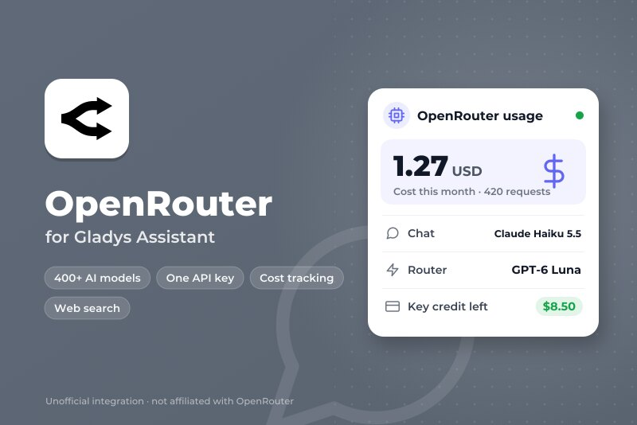
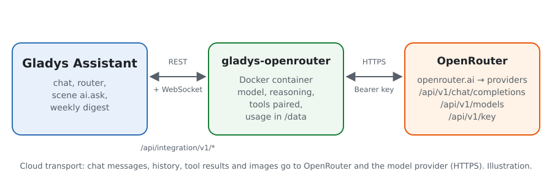
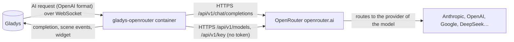
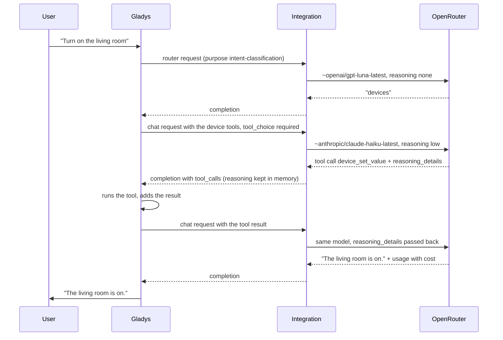
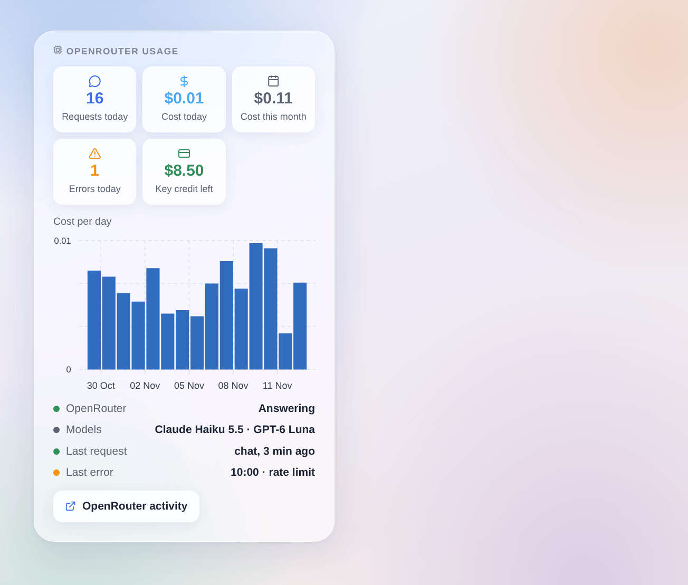

# Gladys OpenRouter

**English** · [Français](README.fr.md) · [Deutsch](README.de.md) · [Español](README.es.md)

[](LICENSE)
[](https://github.com/William-De71/gladys-openrouter/releases)
[](https://github.com/William-De71/gladys-openrouter/actions/workflows/release.yml)
[](https://gladysassistant.com)



[Gladys Assistant](https://gladysassistant.com) external integration that runs the assistant of Gladys on **OpenRouter**: more than 400 AI models (Claude, GPT, Gemini, DeepSeek, Mistral, free open models…) behind one API key and one prepaid balance. Once selected in Settings → Artificial Intelligence, the model you chose answers the chat, controls your devices, creates scenes, answers the "ask the AI" scene action and writes the weekly digest — with or without a Gladys Plus account.

User documentation: [English](docs/en.md) · [Français](docs/fr.md) · [Deutsch](docs/de.md) · [Español](docs/es.md).

Not affiliated with OpenRouter. **Not tested with a real OpenRouter key yet**: the requests follow the official API reference of OpenRouter and its public model list, and the tests run against a fake API. Feedback welcome.

## Features

- **AI provider** (`type: "ai"`, Gladys 5.3+): every AI request of Gladys goes through OpenRouter — the chat with its tool calls, the intent router, the scene "ask the AI" action, the weekly digest.
- **Two models**: a chat model (Claude Haiku by default) and a fast router model (GPT Luna by default), chosen among aliases that follow the newest model of each family, OpenRouter's Auto and Free routers, or any other model id.
- **Reasoning level** of the chat model (off, low, medium, high), adapted to what each model accepts, read from the live model catalog; the reasoning of Claude, Gemini and GPT is passed back with the tool results.
- **Privacy**: restrict the requests to providers without data collection, or with zero data retention.
- **Scene action "ask with web search"**: the chat model searches the web and answers briefly (news, traffic, an event); the answer and the sources are outputs for the next actions.
- **Scene triggers**: the assistant fails (key refused, no credits left, rate limit, model unavailable, API unreachable) and answers again — once per failure.
- **Dashboard widget**: requests, cost of the day and of the month, credit left on the key (or free requests of the day), cost per day over 30 days, last answer and last error.
- **Test the connection** button; the configuration screen shows whether OpenRouter accepts the key and knows the models, without spending anything.
- English, French, German and Spanish.

## How it works





The whole agentic loop (prompts, tools, history, image resizing) stays in Gladys; the integration picks the model and prepares each request and its answer:



What the integration handles: tool calls and results always paired (the ids Gladys writes for calls without one, such as `unknown`, get stable ones; a lone call gets a placeholder result), the `reasoning_details` of reasoning models kept by call id and passed back with the results, the reasoning effort closest to what each model accepts, errors that arrive inside an HTTP 200, and the bounds Gladys puts on a completion. A 429 or a 5xx is retried while the time the core waits allows it (18 s for the router, 110 s for the chat); a 402 (no credits) never is.

### Transport

`transports: ["cloud"]`: everything goes to `openrouter.ai` over HTTPS, then to the provider of the model. **OpenRouter and that provider see every chat message, the history, the tool definitions and results (the state of the devices the assistant reads) and the chat images**, and the answers drive your devices and scenes. Gladys never falls back to Gladys Plus when OpenRouter fails: the chat says what is wrong. `/data` only keeps the usage counters of the widget.

## Models

| Choice                 | Model id                          | Use                                                          | Reasoning               |
| ---------------------- | --------------------------------- | ------------------------------------------------------------ | ----------------------- |
| Claude Haiku, latest   | `~anthropic/claude-haiku-latest`  | Chat (default): fast, cheap, reliable with tools             | off to high             |
| Claude Sonnet, latest  | `~anthropic/claude-sonnet-latest` | Chat: the most capable, about 20 times the price of Haiku    | always on (low to high) |
| GPT Terra, latest      | `~openai/gpt-terra-latest`        | Chat                                                         | off to high             |
| GPT Luna, latest       | `~openai/gpt-luna-latest`         | Router (default) or cheap chat                               | off to high             |
| Gemini Flash, latest   | `~google/gemini-flash-latest`     | Chat                                                         | always on (low to high) |
| DeepSeek Flash, latest | `~deepseek/deepseek-flash-latest` | Chat or router, very cheap                                   | off, low, high          |
| Auto Router            | `openrouter/auto`                 | Chat: OpenRouter picks a model per request                   | as asked                |
| Free models            | `openrouter/free`                 | Chat or router: free, 50 requests a day (1,000 with credits) | as asked                |
| Other model            | your id                           | Any model of openrouter.ai/models that supports tools        | from the catalog        |

The `~…-latest` aliases are moved by OpenRouter to the newest model of each family (checked on 22 November 2026: Claude Haiku 5.5, Claude Sonnet 5.5, GPT-6.1 Terra, GPT-6 Luna, Gemini 4 Hydrogen, DeepSeek V4.1 Flash); the logs, the status and the widget show the real name. The configuration status warns when a model cannot call tools.

## Scenes and widget



- **Action "OpenRouter: ask with web search"**: fields `question` (scene variables allowed), `instructions` (optional); outputs `answer` and `sources` (one per line). Uses the chat model with the `web` plugin of OpenRouter, Exa engine, 5 results (about $0.007 a search on top of the tokens).
- **Trigger "OpenRouter: the assistant fails"**: variables `kind` (`auth`, `credits`, `rate_limit`, `model`, `unreachable`, `timeout`, `server`), `message`, `use`, `model`; filter by kind. A refused request (HTTP 400, moderation, a model that cannot read an image) is about that request only and starts nothing.
- **Trigger "OpenRouter: the assistant answers again"**: variable `down_minutes`.
- **Widget "OpenRouter usage"**: counted by the integration from the `usage` of each answer (cost in credits, 1 credit = 1 US dollar); requests made outside Gladys with the same key are not in it. What the key has left comes from `GET /api/v1/key`. The activity page of OpenRouter stays the reference for the bill.

Examples:

- _Every morning at 7:30_ → **ask with web search** "the three main news of the day in France, in three short sentences" → send `{{answer}}` by Telegram.
- _When the assistant fails_ (kind `credits`) → send an SMS to the administrator: "OpenRouter credits exhausted".
- _Before leaving_ → **ask with web search** "traffic on the A7 between Lyon and Valence now" → speak the answer on the speaker of the hall.

## Requirements

- Gladys Assistant **5.3.0** or later (AI providers); older instances cannot install the integration.
- An OpenRouter account and an API key from [openrouter.ai/keys](https://openrouter.ai/keys).

### Credits and limits

- **Paid models**: billed per token from your prepaid credits, at the price of the provider; OpenRouter adds a fee when you buy credits, not on the tokens. A credit limit on the key caps what Gladys can spend.
- **Free models**: 20 requests a minute and 50 a day, 1,000 a day once 10 credits were bought (reset at midnight UTC). A chat turn makes at least two requests (router, then chat), more when tools are called.
- **Privacy**: by default any provider of the model may serve the request; the **Providers** setting restricts it (`provider.data_collection: "deny"`, or `provider.zdr: true`).

## Installation

- **From the store**: Integrations → OpenRouter → Install.
- **From the repository URL**: Integrations → external integration → `https://github.com/William-De71/gladys-openrouter`.
- **Developer mode**: run `npm start` with the variables given by Gladys (see Development).

## Configuration

| Field or button       | Default                        | Meaning                                                                |
| --------------------- | ------------------------------ | ---------------------------------------------------------------------- |
| OpenRouter API key    | —                              | Required, a secret: never shown again, never logged                    |
| Chat model            | Claude Haiku, latest           | Chat, scene creation, weekly digest, web search action                 |
| Router model          | GPT Luna, latest               | Sorts every message before the answer, within 20 s                     |
| Other model id        | —                              | Used when a model is set to "Other model"                              |
| Reasoning             | low                            | Of the chat model; the router gets the lowest level its model accepts  |
| Maximum answer length | 8000 tokens                    | Reasoning included; raise it if the logs say an answer hit max_tokens  |
| Providers             | All the providers of the model | Or without data collection, or zero data retention only                |
| Test the connection   | —                              | One short answer from each model, with its time (a fraction of a cent) |

## Usage

1. In Gladys (Integrations → OpenRouter → Configuration): paste the API key, choose the models; press **Test the connection**.
2. Settings → **Artificial Intelligence**: choose **OpenRouter** as the provider.
3. Talk to Gladys in the chat; add the widget to a dashboard; use the triggers and the web search action in your scenes.

## Development

```bash
npm install
npm test                       # node --test, a fake OpenRouter API on 127.0.0.1, never the network
npm run lint                   # ESLint
npm run format:check           # Prettier
npx github:GladysAssistant/integration-store . --skip-image-check
scripts/build-cover.sh         # cover.jpg from docs/assets/cover.svg
docs/illustrations/render.sh   # docs/assets/widgets.<lang>.png
```

Locally, the SDK reads `GLADYS_HOST_API_URL`, `GLADYS_INTEGRATION_TOKEN` and `GLADYS_INTEGRATION_SELECTOR` (given by Gladys in developer mode), and the integration reads `TZ`. `DEBUG=gladys-integration-sdk` shows the SDK logs.

The tests cover the HTTP client (errors, errors inside a 200, retries, deadlines), the model catalog, the conversion both ways (`validateAiCompletion` of the SDK, pairing, reasoning details), the chat handler (models per purpose, reasoning, privacy, refused parameter), the web search, the triggers, the usage counters, the widget (`validateWidgetContent`), the manifest, the four languages, the release script, and the whole integration against the fake Gladys of the SDK. `test/structure.test.js` freezes every key users store.

## Release process


Every merge on `main` runs the CI, then computes the version from the [Conventional Commits](https://www.conventionalcommits.org/) since the last tag: `feat` → minor, `fix` / `perf` → patch, `!` or `BREAKING CHANGE` → major (a minor below 1.0.0); `docs`, `chore`, `ci`, `test`, `style`, `refactor`, `build` alone publish nothing. The changelog section is generated, the tag pushed, the multi-architecture image built, then `main` receives the release commit, the GitHub Release is created and a last job checks the public image, the store validator and the topic.

- The pull request title becomes the squash commit, then the changelog line: write it in English, for the user (`pr-title.yml` checks it). Never edit `CHANGELOG.md` by hand.
- 1.0.0 is a decision: Actions → Release → Run workflow with `release-as: 1.0.0`. `dry-run` shows the version and the notes without publishing.
- **Protected branch**: rulesets require a pull request on `main` and lock the `v*` tags; only the maintainer and deploy keys get through. The release pushes with the deploy key of the `release` environment (secret `RELEASE_DEPLOY_KEY`, `main` only): a run from another branch never gets it. `build.yml` and `github-release.yml` do not start on a tag: the release calls them, or run them by hand (Actions → Run workflow, with `version` for the image) to finish a release.
- After the first release, make the `ghcr.io` package public (Package settings → Change visibility), or Gladys cannot pull it.

## Troubleshooting

See [docs/en.md](docs/en.md#troubleshooting). Report issues with the versions of Gladys and of the integration, the models chosen, the Providers setting and the message of **Test the connection**. Never paste your API key.

## Contributing

Issues and pull requests are welcome, especially from people with an OpenRouter key: a failing request (without the key) helps a lot. Run `npm run format:check && npm run lint && npm test` before opening a pull request, and keep every stored key unchanged (see [CLAUDE.md](CLAUDE.md)).

## Security

See [SECURITY.md](SECURITY.md): report vulnerabilities privately. The API key is a `secret` field: never logged, never written to `/data`, sent only to `openrouter.ai` over HTTPS.

## Screenshots to come

The images above are illustrations, not screenshots. Real screenshots will go in `docs/assets/screenshots/` (PNG, 1280 × 800): `configuration.png` (the configuration with its status), `ai-settings.png` (OpenRouter chosen in Settings → Artificial Intelligence), `chat.png` (a chat that switches a device on), `scene-web-search.png` (the web search action in a scene).

## License

[Apache License 2.0](LICENSE) — see also [NOTICE](NOTICE). OpenRouter is a trademark of OpenRouter, Inc.; model names belong to their owners. This project is not affiliated with, endorsed or sponsored by OpenRouter. Thanks to the Gladys documentation and SDK, and to the OpenRouter documentation.
