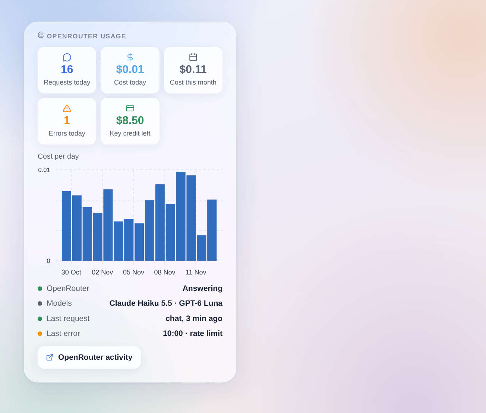

# OpenRouter

## Overview

This integration runs the assistant of Gladys on **OpenRouter**, a service that gives access to more than 400 AI models (Anthropic Claude, OpenAI GPT, Google Gemini, DeepSeek, Mistral, Qwen, free open models…) with a single API key and a single prepaid balance. Once you choose it in **Settings → Artificial Intelligence**, every AI request of Gladys goes through OpenRouter: the chat and the devices it controls, the scenes it creates, the "ask the AI" scene action and the weekly digest. It works with or without a Gladys Plus account.

It also adds a scene action that asks a question **with web search**, two scene triggers (the assistant fails, the assistant answers again) and a dashboard widget with the requests, the **cost** and the credit left on the key.

Not affiliated with OpenRouter. Not tested with a real OpenRouter key yet: feedback welcome.

## Prerequisites

- Gladys Assistant 5.3.0 or later.
- An OpenRouter account and an API key: [openrouter.ai/keys](https://openrouter.ai/keys) → **Create API key**. You can give the key a **credit limit**: Gladys can then never spend more.
- **Credits**: the paid models are billed per token from your prepaid balance, at the price of the provider ([openrouter.ai/models](https://openrouter.ai/models)). With the default models, a chat message costs a fraction of a cent.
- **Free models** (the "Free models" choice, ids ending in `:free`): 20 requests a minute and 50 a day, 1,000 a day once you have bought 10 credits. The router counts one request per chat message, so a free setup allows about 25 messages a day. Their providers often keep or train on the requests.
- What leaves your home: every chat message, the history, the tools Gladys offers and their results (the state of the devices the assistant reads) and the chat images go to OpenRouter over HTTPS, then to the provider of the model. The answers control your devices and create scenes.

## Configuration

| Field or button                | Default                        | Meaning                                                                                    |
| ------------------------------ | ------------------------------ | ------------------------------------------------------------------------------------------ |
| OpenRouter API key             | —                              | Required (it starts with `sk-or-`). Never shown again, never logged                        |
| Chat model                     | Claude Haiku, latest           | Answers the chat, creates scenes, writes the weekly digest, runs the web search action     |
| Router model                   | GPT Luna, latest               | Sorts every message before the answer and must reply within 20 seconds                     |
| Other model id                 | —                              | Only when a model is set to "Other model": the exact id from openrouter.ai/models (tools!) |
| Reasoning of the chat model    | Low                            | More reasoning, better scenes, slower and more expensive answers                           |
| Maximum answer length (tokens) | 8000                           | Reasoning included                                                                         |
| Providers                      | All the providers of the model | Restrict to providers without data collection, or with zero data retention                 |
| Test the connection            | —                              | One short answer from each model with its time; costs a fraction of a cent                 |

The status of the configuration screen says whether OpenRouter accepts the key and knows both models, without spending anything, and warns when a model cannot call tools, when the credit of the key is exhausted or when a free model is chosen.

## Usage

1. Integrations → **OpenRouter** → Configuration: paste the API key, keep the default models, press **Test the connection**.
2. Settings → **Artificial Intelligence**: choose **OpenRouter**.
3. Talk to Gladys in the chat: "turn on the living room", "what is the temperature in the bedroom?", "create a scene that closes the shutters at sunset".

### Choosing the models

The "latest" choices are aliases kept up to date by OpenRouter: they always point to the newest model of the family (Claude Haiku 5.5 today), so the setting never goes stale.

- **Claude Haiku** (default for the chat): fast, cheap and reliable with tools.
- **Claude Sonnet**: the most capable for complex scenes, about 20 times the price of Haiku; it always reasons.
- **GPT Terra / GPT Luna**: the OpenAI models; GPT Luna, the default router, is very cheap and can answer without reasoning.
- **Gemini Flash**, **DeepSeek Flash**: other fast models; Gemini always reasons a little.
- **Auto Router**: OpenRouter picks a model for each request; you pay the model it picked.
- **Free models**: OpenRouter picks a free model; limited, see Prerequisites.
- **Other model**: any id of [openrouter.ai/models](https://openrouter.ai/models) that supports tools, such as `mistralai/mistral-large-4-0` or a `:free` variant.

Each model gets the reasoning level closest to the one you chose among those it accepts; the router always gets the lowest. If a model refuses the reasoning parameter, the integration sends it without from then on.

### Dashboard widget

The **OpenRouter usage** widget shows the requests, the cost and the errors of the day, the cost of the month, what the key has left (its credit limit, or the free requests of the day), the cost per day over 30 days (tokens when everything was free), whether OpenRouter answers, the models, the last request and the last error. It counts what Gladys asked; the activity page of OpenRouter stays the reference for the bill.

### Scenes

- **Action "OpenRouter: ask with web search"**: the chat model searches the web (5 results through Exa, about $0.007 on top of the tokens) and answers in a few sentences. Fields: the question (scene variables allowed), extra instructions. Outputs: the answer and the sources, one per line.
- **Trigger "OpenRouter: the assistant fails"**: once per failure (key refused, no credits left, rate limit, model unavailable, API unreachable, too slow, provider error), with the kind, the message, the request and the model.
- **Trigger "OpenRouter: the assistant answers again"**: the first answer after a failure, with the minutes of failure.

Examples: every morning, ask with web search for the news of the day and send the answer by Telegram; when the assistant fails because no credits are left, send an SMS to the administrator.

## Troubleshooting

- **"OpenRouter refused the API key"**: copy the key again from openrouter.ai/keys; a deleted or disabled key gives the same message.
- **"No OpenRouter credits left"**: add credits on openrouter.ai, or raise the credit limit of the key.
- **"Rate limit reached"**: usually the daily cap of the free models. Wait for midnight UTC, buy 10 credits (1,000 free requests a day) or choose a paid router model.
- **"… is not available on OpenRouter"**: the model id is wrong or the model was removed; or the **Providers** setting leaves no provider for it (free models often need "All the providers").
- **The chat answers without doing anything**: the chosen model may not call tools (see the status); try Claude Haiku.
- **"The answer was cut at max_tokens"**: raise the maximum answer length.
- **An image in the chat fails**: the chosen model may not read images; the models of the list all do.
- Logs: Settings → Supervision, the logs of the integration. Never share your API key.
