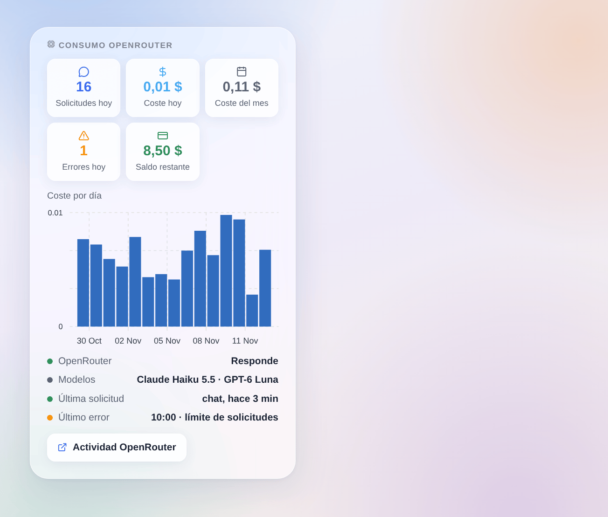

# OpenRouter

## Presentación

Esta integración hace funcionar el asistente de Gladys con **OpenRouter**, un servicio que da acceso a más de 400 modelos de IA (Anthropic Claude, OpenAI GPT, Google Gemini, DeepSeek, Mistral, Qwen, modelos abiertos gratuitos…) con una sola clave de API y un solo saldo prepago. Una vez elegida en **Ajustes → Inteligencia artificial**, cada solicitud de IA de Gladys pasa por OpenRouter: el chat y los dispositivos que controla, las escenas que crea, la acción de escena «preguntar a la IA» y el resumen semanal. Funciona con o sin cuenta de Gladys Plus.

También añade una acción de escena que hace una pregunta **con búsqueda web**, dos disparadores de escena (el asistente falla, el asistente vuelve a responder) y un widget del panel con las solicitudes, el **coste** y el crédito que le queda a la clave.

Sin relación con OpenRouter. Todavía no probada con una clave real de OpenRouter: se agradecen los comentarios.

## Requisitos

- Gladys Assistant 5.3.0 o posterior.
- Una cuenta de OpenRouter y una clave de API: [openrouter.ai/keys](https://openrouter.ai/keys) → **Create API key**. Puede dar a la clave un **límite de crédito**: así Gladys nunca podrá gastar más.
- **Créditos**: los modelos de pago se facturan por token de su saldo prepago, al precio del proveedor ([openrouter.ai/models](https://openrouter.ai/models)). Con los modelos por defecto, un mensaje del chat cuesta una fracción de céntimo.
- **Modelos gratuitos** (la opción «Modelos gratuitos», identificadores que terminan en `:free`): 20 solicitudes por minuto y 50 al día, 1000 al día una vez comprados 10 créditos. El enrutador cuenta una solicitud por mensaje del chat, así que una configuración gratuita permite unos 25 mensajes al día. Sus proveedores suelen conservar las solicitudes o entrenar con ellas.
- Lo que sale de su casa: cada mensaje del chat, el historial, las herramientas que ofrece Gladys y sus resultados (el estado de los dispositivos que consulta el asistente) y las imágenes del chat van a OpenRouter por HTTPS y después al proveedor del modelo. Las respuestas controlan sus dispositivos y crean escenas.

## Configuración

| Campo o botón                             | Por defecto                      | Significado                                                                                                   |
| ----------------------------------------- | -------------------------------- | ------------------------------------------------------------------------------------------------------------- |
| Clave de API de OpenRouter                | —                                | Obligatoria (empieza por `sk-or-`). Nunca se vuelve a mostrar ni se registra                                  |
| Modelo del chat                           | Claude Haiku, última versión     | Responde al chat, crea las escenas, redacta el resumen semanal, ejecuta la acción de búsqueda web             |
| Modelo del enrutador                      | GPT Luna, última versión         | Clasifica cada mensaje antes de la respuesta y debe contestar en menos de 20 segundos                         |
| Identificador del otro modelo             | —                                | Solo si un modelo está en «Otro modelo»: el identificador exacto de openrouter.ai/models (¡con herramientas!) |
| Razonamiento del modelo del chat          | Bajo                             | Más razonamiento, mejores escenas, respuestas más lentas y más caras                                          |
| Longitud máxima de una respuesta (tokens) | 8000                             | Razonamiento incluido                                                                                         |
| Proveedores                               | Todos los proveedores del modelo | Limitar a proveedores sin recogida de datos, o con retención cero                                             |
| Probar la conexión                        | —                                | Una respuesta corta de cada modelo con su tiempo; cuesta una fracción de céntimo                              |

El estado de la pantalla de configuración indica si OpenRouter acepta la clave y conoce los dos modelos, sin gastar nada, y avisa cuando un modelo no puede llamar a herramientas, cuando el crédito de la clave se ha agotado o cuando se ha elegido un modelo gratuito.

## Uso

1. Integraciones → **OpenRouter** → Configuración: pegue la clave de API, conserve los modelos por defecto, pulse **Probar la conexión**.
2. Ajustes → **Inteligencia artificial**: elija **OpenRouter**.
3. Hable con Gladys en el chat: «enciende el salón», «¿qué temperatura hace en el dormitorio?», «crea una escena que cierre las persianas al atardecer».

### Elegir los modelos

Las opciones «última versión» son alias que OpenRouter mantiene al día: siempre apuntan al modelo más reciente de la familia (hoy Claude Haiku 5.5), así que el ajuste nunca se queda anticuado.

- **Claude Haiku** (por defecto para el chat): rápido, barato y fiable con las herramientas.
- **Claude Sonnet**: el más capaz para escenas complejas, unas 20 veces el precio de Haiku; siempre razona.
- **GPT Terra / GPT Luna**: los modelos de OpenAI; GPT Luna, el enrutador por defecto, es muy barato y puede responder sin razonar.
- **Gemini Flash**, **DeepSeek Flash**: otros modelos rápidos; Gemini siempre razona un poco.
- **Auto Router**: OpenRouter elige un modelo para cada solicitud; usted paga el modelo elegido.
- **Modelos gratuitos**: OpenRouter elige un modelo gratuito; limitado, vea Requisitos.
- **Otro modelo**: cualquier identificador de [openrouter.ai/models](https://openrouter.ai/models) que admita herramientas, como `mistralai/mistral-large-4-0` o una variante `:free`.

Cada modelo recibe, entre los niveles de razonamiento que acepta, el más cercano al que usted eligió; el enrutador recibe siempre el más bajo. Si un modelo rechaza el parámetro de razonamiento, la integración lo envía sin él a partir de entonces.

### Widget del panel

El widget **Consumo OpenRouter** muestra las solicitudes, el coste y los errores del día, el coste del mes, lo que le queda a la clave (su límite de crédito, o las solicitudes gratuitas del día), el coste por día durante 30 días (tokens cuando todo era gratuito), si OpenRouter responde, los modelos, la última solicitud y el último error. Cuenta lo que Gladys pidió; la página de actividad de OpenRouter sigue siendo la referencia para la factura.

### Escenas

- **Acción «OpenRouter: preguntar con búsqueda web»**: el modelo del chat busca en la web (5 resultados mediante Exa, unos $0.007 además de los tokens) y responde en pocas frases. Campos: la pregunta (se admiten variables de escena), instrucciones adicionales. Salidas: la respuesta y las fuentes, una por línea.
- **Disparador «OpenRouter: el asistente falla»**: una vez por fallo (clave rechazada, sin créditos, límite de solicitudes, modelo no disponible, API inaccesible, demasiado lento, error del proveedor), con el tipo, el mensaje, la solicitud y el modelo.
- **Disparador «OpenRouter: el asistente vuelve a responder»**: la primera respuesta tras un fallo, con los minutos de fallo.

Ejemplos: cada mañana, preguntar con búsqueda web por las noticias del día y enviar la respuesta por Telegram; cuando el asistente falla por falta de créditos, enviar un SMS al administrador.

## Solución de problemas

- **«OpenRouter ha rechazado la clave de API»**: vuelva a copiar la clave desde openrouter.ai/keys; una clave borrada o desactivada da el mismo mensaje.
- **«No quedan créditos de OpenRouter»**: añada créditos en openrouter.ai, o aumente el límite de crédito de la clave.
- **«Se ha alcanzado el límite de solicitudes»**: normalmente el tope diario de los modelos gratuitos. Espere a medianoche UTC, compre 10 créditos (1000 solicitudes gratuitas al día) o elija un modelo de enrutador de pago.
- **«… no está disponible en OpenRouter»**: el identificador del modelo es incorrecto o el modelo se ha retirado; o el ajuste **Proveedores** no le deja ningún proveedor (los modelos gratuitos suelen necesitar «Todos los proveedores del modelo»).
- **El chat responde sin hacer nada**: puede que el modelo elegido no sepa llamar a herramientas (vea el estado); pruebe Claude Haiku.
- **«La respuesta se cortó en max_tokens»**: aumente la longitud máxima de una respuesta.
- **Falla una imagen del chat**: puede que el modelo elegido no lea imágenes; los modelos de la lista las leen todos.
- Registros: Ajustes → Supervisión, los registros de la integración. No comparta nunca su clave de API.
