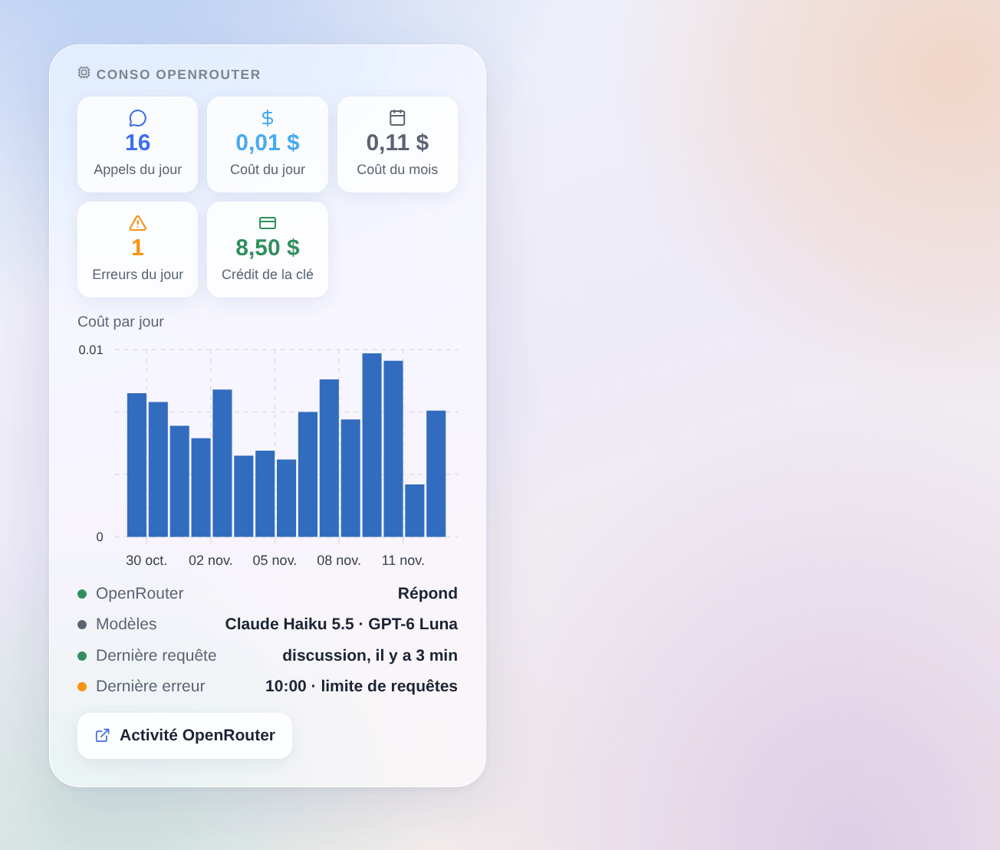

# OpenRouter

## Présentation

Cette intégration fait tourner l’assistant de Gladys sur **OpenRouter**, un service qui donne accès à plus de 400 modèles d’IA (Anthropic Claude, OpenAI GPT, Google Gemini, DeepSeek, Mistral, Qwen, modèles ouverts gratuits…) avec une seule clé d’API et un seul solde prépayé. Une fois choisie dans **Paramètres → Intelligence artificielle**, chaque requête d’IA de Gladys passe par OpenRouter : le chat et les appareils qu’il pilote, les scènes qu’il crée, l’action de scène « demander à l’IA » et le résumé hebdomadaire. Elle fonctionne avec ou sans compte Gladys Plus.

Elle ajoute aussi une action de scène qui pose une question **avec recherche web**, deux déclencheurs de scène (l’assistant est en erreur, l’assistant répond de nouveau) et un widget de tableau de bord avec les requêtes, le **coût** et le crédit restant sur la clé.

Sans lien avec OpenRouter. Pas encore testée avec une vraie clé OpenRouter : vos retours sont bienvenus.

## Prérequis

- Gladys Assistant 5.3.0 ou plus récent.
- Un compte OpenRouter et une clé d’API : [openrouter.ai/keys](https://openrouter.ai/keys) → **Create API key**. Vous pouvez donner à la clé une **limite de crédit** : Gladys ne pourra alors jamais dépenser plus.
- **Crédits** : les modèles payants sont facturés au jeton sur votre solde prépayé, au prix du fournisseur ([openrouter.ai/models](https://openrouter.ai/models)). Avec les modèles par défaut, un message du chat coûte une fraction de centime.
- **Modèles gratuits** (le choix « Modèles gratuits », identifiants terminés par `:free`) : 20 requêtes par minute et 50 par jour, 1 000 par jour une fois 10 crédits achetés. Le routeur compte une requête par message du chat : une configuration gratuite permet donc environ 25 messages par jour. Leurs fournisseurs conservent souvent les requêtes ou s’en servent pour l’entraînement.
- Ce qui sort de chez vous : chaque message du chat, l’historique, les outils que Gladys propose et leurs résultats (l’état des appareils que l’assistant consulte) et les images du chat partent chez OpenRouter en HTTPS, puis chez le fournisseur du modèle. Les réponses pilotent vos appareils et créent des scènes.

## Configuration

| Champ ou bouton                          | Par défaut                      | Rôle                                                                                                                      |
| ---------------------------------------- | ------------------------------- | ------------------------------------------------------------------------------------------------------------------------- |
| Clé d’API OpenRouter                     | —                               | Obligatoire (elle commence par `sk-or-`). Plus jamais affichée, jamais journalisée                                        |
| Modèle du chat                           | Claude Haiku, dernière version  | Répond au chat, crée les scènes, rédige le résumé hebdomadaire, exécute l’action de recherche web                         |
| Modèle du routeur                        | GPT Luna, dernière version      | Trie chaque message avant la réponse et doit répondre en moins de 20 secondes                                             |
| Identifiant de l’autre modèle            | —                               | Seulement si un modèle est réglé sur « Autre modèle » : l’identifiant exact repris d’openrouter.ai/models (avec outils !) |
| Réflexion du modèle du chat              | Faible                          | Plus de réflexion, de meilleures scènes, des réponses plus lentes et plus chères                                          |
| Longueur maximale d’une réponse (jetons) | 8000                            | Réflexion comprise                                                                                                        |
| Fournisseurs                             | Tous les fournisseurs du modèle | Se limiter aux fournisseurs sans collecte de données, ou à zéro conservation                                              |
| Tester la connexion                      | —                               | Une réponse courte de chaque modèle avec son temps ; coûte une fraction de centime                                        |

Le statut de l’écran de configuration indique si OpenRouter accepte la clé et connaît les deux modèles, sans rien dépenser, et prévient quand un modèle ne sait pas appeler d’outils, quand le crédit de la clé est épuisé ou quand un modèle gratuit est choisi.

## Utilisation

1. Intégrations → **OpenRouter** → Configuration : collez la clé d’API, gardez les modèles par défaut, appuyez sur **Tester la connexion**.
2. Paramètres → **Intelligence artificielle** : choisissez **OpenRouter**.
3. Parlez à Gladys dans le chat : « allume le salon », « quelle température dans la chambre ? », « crée une scène qui ferme les volets au coucher du soleil ».

### Choisir les modèles

Les choix « dernière version » sont des alias tenus à jour par OpenRouter : ils pointent toujours vers le modèle le plus récent de la famille (Claude Haiku 5.5 aujourd’hui), le réglage ne devient donc jamais obsolète.

- **Claude Haiku** (par défaut pour le chat) : rapide, bon marché et fiable avec les outils.
- **Claude Sonnet** : le plus capable pour les scènes complexes, environ 20 fois le prix de Haiku ; il réfléchit toujours.
- **GPT Terra / GPT Luna** : les modèles d’OpenAI ; GPT Luna, le routeur par défaut, est très bon marché et peut répondre sans réflexion.
- **Gemini Flash**, **DeepSeek Flash** : d’autres modèles rapides ; Gemini réfléchit toujours un peu.
- **Auto Router** : OpenRouter choisit un modèle pour chaque requête ; vous payez le modèle qu’il a choisi.
- **Modèles gratuits** : OpenRouter choisit un modèle gratuit ; limité, voir Prérequis.
- **Autre modèle** : n’importe quel identifiant d’[openrouter.ai/models](https://openrouter.ai/models) qui gère les outils, comme `mistralai/mistral-large-4-0` ou une variante `:free`.

Chaque modèle reçoit, parmi les niveaux de réflexion qu’il accepte, le plus proche de celui que vous avez choisi ; le routeur reçoit toujours le plus bas. Si un modèle refuse le paramètre de réflexion, l’intégration l’envoie sans, désormais.

### Widget de tableau de bord

Le widget **Conso OpenRouter** affiche les requêtes, le coût et les erreurs du jour, le coût du mois, ce qu’il reste sur la clé (sa limite de crédit, ou les requêtes gratuites du jour), le coût par jour sur 30 jours (les jetons quand tout était gratuit), si OpenRouter répond, les modèles, la dernière requête et la dernière erreur. Il compte ce que Gladys a demandé ; la page d’activité d’OpenRouter reste la référence pour la facture.

### Scènes

- **Action « OpenRouter : demander avec recherche web »** : le modèle du chat cherche sur le web (5 résultats via Exa, environ $0.007 en plus des jetons) et répond en quelques phrases. Champs : la question (variables de scène acceptées), des consignes en plus. Sorties : la réponse et les sources, une par ligne.
- **Déclencheur « OpenRouter : l’assistant est en erreur »** : une fois par panne (clé refusée, plus de crédits, limite de requêtes, modèle indisponible, API injoignable, trop lent, erreur du fournisseur), avec le type, le message, la requête et le modèle.
- **Déclencheur « OpenRouter : l’assistant répond de nouveau »** : la première réponse après une panne, avec les minutes de panne.

Exemples : chaque matin, demander avec recherche web les actualités du jour et envoyer la réponse par Telegram ; quand l’assistant est en erreur faute de crédits, envoyer un SMS à l’administrateur.

## Dépannage

- **« OpenRouter a refusé la clé d’API »** : recopiez la clé depuis openrouter.ai/keys ; une clé supprimée ou désactivée donne le même message.
- **« Plus de crédits OpenRouter »** : ajoutez des crédits sur openrouter.ai, ou relevez la limite de crédit de la clé.
- **« Limite de requêtes atteinte »** : en général le plafond quotidien des modèles gratuits. Attendez minuit UTC, achetez 10 crédits (1 000 requêtes gratuites par jour) ou choisissez un modèle de routeur payant.
- **« … n’est pas disponible sur OpenRouter »** : l’identifiant du modèle est faux ou le modèle a été retiré ; ou le réglage **Fournisseurs** ne lui laisse aucun fournisseur (les modèles gratuits demandent souvent « Tous les fournisseurs du modèle »).
- **Le chat répond sans rien faire** : le modèle choisi ne sait peut-être pas appeler d’outils (voir le statut) ; essayez Claude Haiku.
- **« La réponse a été coupée à max_tokens »** : augmentez la longueur maximale d’une réponse.
- **Une image du chat échoue** : le modèle choisi ne lit peut-être pas les images ; les modèles de la liste les lisent tous.
- Journaux : Paramètres → Supervision, les journaux de l’intégration. Ne partagez jamais votre clé d’API.
